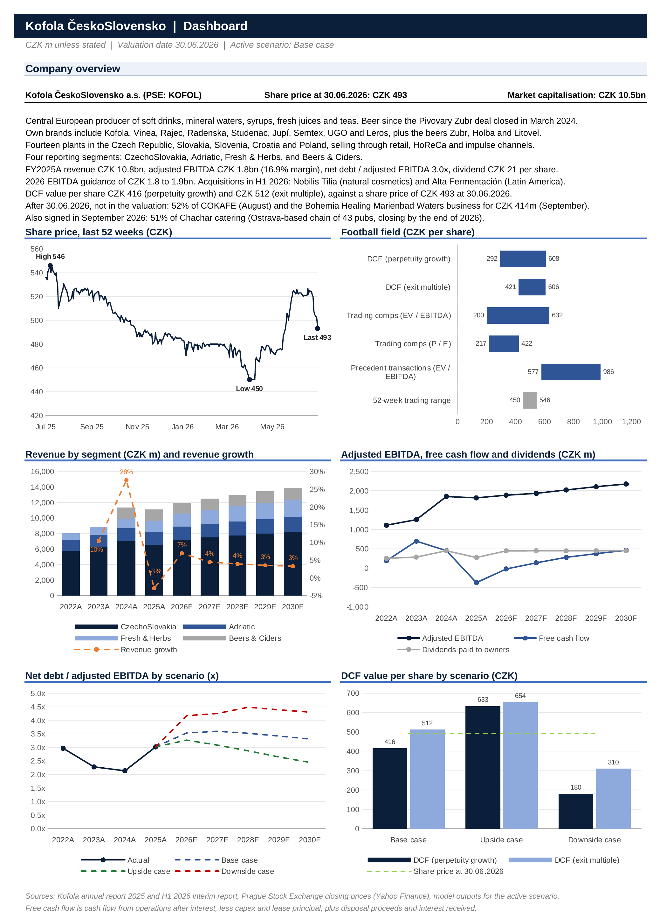

# Kofola ČeskoSlovensko Valuation Model

An Excel valuation model of Kofola ČeskoSlovensko a.s. (Prague Stock Exchange: KOFOL), the Czech and Slovak producer of soft drinks, mineral waters and beer. A three-statement forecast to 2030 feeds a DCF (perpetuity growth and exit multiple), trading comparables and precedent transactions, with Base, Upside and Downside scenarios.

Built in 2026. The valuation date is 30 June 2026, with H1 2026 as the latest reported period and a share price of CZK 493 (Prague Stock Exchange close on that day). All figures are in CZK millions unless stated.

> **Student project.** Not investment advice. The model gives no rating or target price. Kofola's figures come from its published reports, and this work is not affiliated with or endorsed by Kofola ČeskoSlovensko a.s.

## Files

| File | Contents |
|---|---|
| [`Balko_Kofola_Valuation_Model.xlsx`](Balko_Kofola_Valuation_Model.xlsx) | Three-statement model 2022A-2030F, DCF, trading comps, precedent transactions, scenarios and sensitivities |

## Key results

Base case, value per share.

| Method | CZK |
|---|---:|
| DCF, perpetuity growth (WACC 6.6%, growth 2.0%) | 416 |
| DCF, exit multiple (9.3x EV / EBITDA) | 512 |
| Trading comps, median EV / LTM EBITDA | 452 |
| Average of the three | 460 |
| Share price, 30 June 2026 | 493 |

The average of the three base values is 7% below the share price. P / E comps and precedent transactions are shown in the football field as cross-checks only. The DCF gives CZK 633 / 654 in the Upside case and CZK 180 / 310 in the Downside case, where net debt / EBITDA stays above 4x to 2030.

## Model

| Sheet | Contents |
|---|---|
| Cover | Contents, conventions and model checks |
| Dashboard | One-page summary with the charts above |
| Outputs | Scenario switch, DCF summary, football field, scenario tables and sensitivities |
| Inputs | Forecast drivers by scenario, financing and tax, WACC and terminal growth |
| Model | Revenue and cost schedules, income statement, balance sheet, cash flow, working capital, PP&E, debt, DCF |
| Comps | Trading comparables and precedent transactions |
| Hist | Reported figures from the annual and interim reports |

- Revenue is built by Kofola's four reporting segments (CzechoSlovakia, Adriatic, Fresh & Herbs, Beers & Ciders). Costs are forecast by nature, and 2026 EBITDA sits within the company's CZK 1.8-1.9bn guidance.
- Cash comes from the cash flow statement, so the balance sheet balances without a plug. Interest is charged on opening balances, so there is no circularity.
- The DCF starts at the 30 June 2026 valuation date: the H1 2026 actual cash flow is taken out of the 2026 forecast, and cash flows are discounted at mid-period.
- Lease liabilities are in net debt, and new right-of-use assets are treated like capex in the free cash flow.
- Peers are Coca-Cola HBC, A.G. Barr, Royal Unibrew and Olvi. Fever-Tree is shown but left out of the statistics. Kofola's LTM EBITDA is adjusted for the 2025 bonus release.
- Pick the scenario in the drop-down on Cover, Outputs or Inputs. Blue numbers are hardcoded inputs, black numbers are formulas. The Cover sheet checks EBITDA and net profit against reported figures, the balance sheet, cash and the DCF against Excel's XNPV, in every scenario.
- Open the file in desktop Excel. The drop-downs are form controls and the sensitivities are Excel data tables. The dashboard image above was rendered outside Excel, so the dashed average line in the football field only shows in Excel.

## Sources

- Kofola annual reports 2022-2025 and the H1 2026 interim report
- The peers' FY2025 and H1 2026 results
- Damodaran (equity risk premium, Czech country risk premium, unlevered beta) and OECD (Czech 10-year government bond yield)
- Prague Stock Exchange closing prices via Yahoo Finance
- The acquirers' announcements for the precedent transactions

Matúš Balko, 2026
